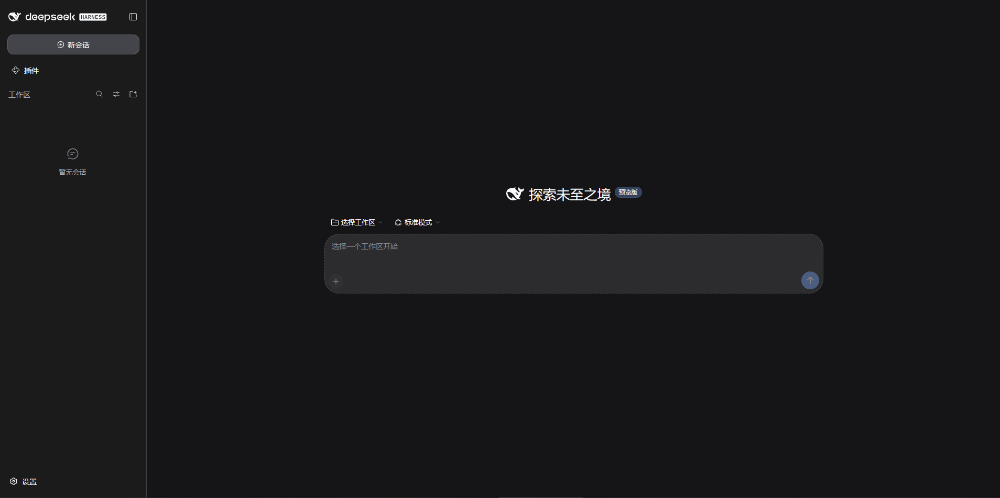
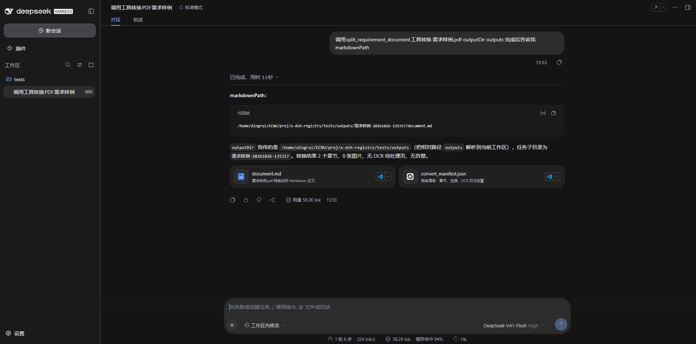

x-dsh
---

## 1 QUICK START

### 1.1 编译

```sh
./build.sh
```

### 1.2 配置文件

```sh
cp .env.example .env
```

> 填写或修改对应配置项目 尤其`DEEPSEEK_API_KEY`和`X_HARNESS_TOKEN`

### 1.3 启动

```sh
./run.sh
```

### 1.4 交互

默认会自动拉起本地服务或者手动访问本地浏览器

```sh
http://127.0.0.1:8080/
```

## 2 SAMPLES

### 2.1 设置工作区



### 2.2 web会话输入

- 显式指定输出路径 `调用split_requirement_document工具转换 需求样例.xlsx outputDir outputs 完成后告诉我markdownPath`

- 使用默认输出路径 `调用split_requirement_document工具转换 需求样例.pdf 完成后告诉我markdownPath`

