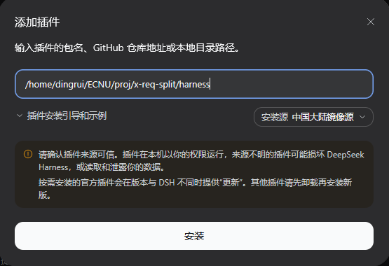
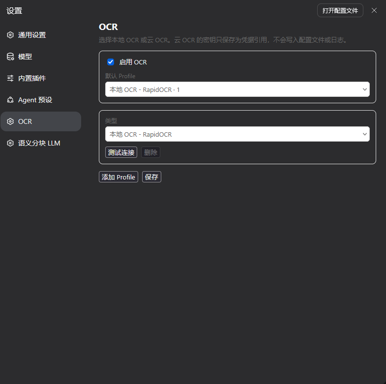
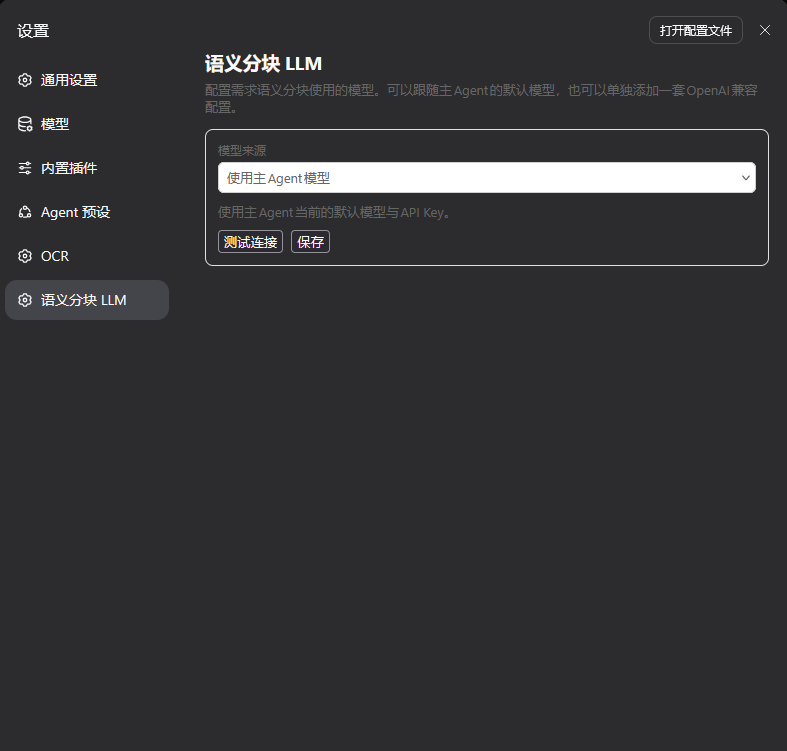

REQ-SPLIT
---

文档格式转换/拆分/语义重组

## 1 QUICK START

### 1.1 编译

```sh
./build.sh --clean
```

### 1.2 启动

#### 1.2.1 直接启动

```sh
./run.sh
```

#### 1.2.2 插件启动



重启`npx @deepseek-ai/dsh web`或desktop app

### 1.3 配置OCR



### 1.5 配置语义分块LLM



## 2 SAMPLES

### 2.1 设置工作区


### 2.2 web会话输入

> 以下方式都行

- 02-跨章节合并.docx
- 转换02-跨章节合并.docx
- 转换02-跨章节合并.docx outputDir设为outputs
- 调用split_requirement_document工具转换02-跨章节合并.docx outputDir设为outputs


### 2.3 输出结构

每次任务创建独立目录，不会覆盖已有结果：

```text
<outputRoot>/<文档名>-<时间戳>/
├── document.md                 # 转换后的 Markdown(中间产物)
├── document.normalized.md      # 统一章节编号后的 Markdown(中间产物)
├── convert_manifest.json       # 图片、待 OCR 页、告警
├── source/                     # 源文件副本
├── assets/                     # 抽取出的原始图片
└── requirements/
    ├── chunks.json             # 语义分块结果
    ├── split_report.json       # 拆分与校验报告
    ├── assets_report.json      # 图片跟随/悬空引用报告
    ├── report.json             # 最终汇总（需求/合并/图片/OCR/告警）
    ├── final.md                # 按文档顺序拼接的完整 Markdown（导出/阅读用）
    ├── requirement_relations.json
    └── <功能目录>/
        ├── <功能>.md           # 条目化需求
        └── assets/             # 跟随该需求的图片
```